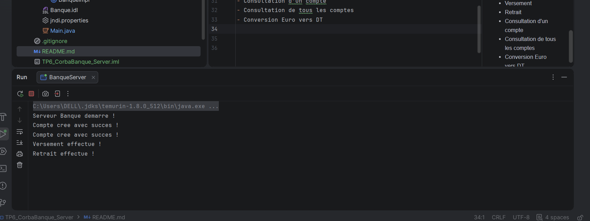
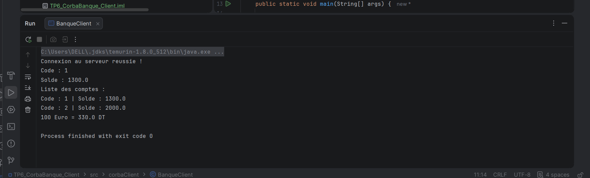

# TP6 - Service Banque en CORBA

## 1. Objectif
Réaliser une application distribuée Client-Serveur
en Java avec le middleware CORBA.

## 2. Environnement
- IntelliJ IDEA
- JDK 8
- Java
- CORBA
- Git et GitHub

## 3. Partie Serveur
- Création de Banque.idl
- Compilation IDL
- Implémentation de BanqueImpl
- Création de BanqueServer
- Configuration JNDI

## 4. Partie Client
- Création du projet Client
- Compilation IDL
- Implémentation de BanqueClient

## 5. Tests
- Création d'un compte
- Versement
- Retrait
- Consultation d'un compte
- Consultation de tous les comptes
- Conversion Euro vers DT

